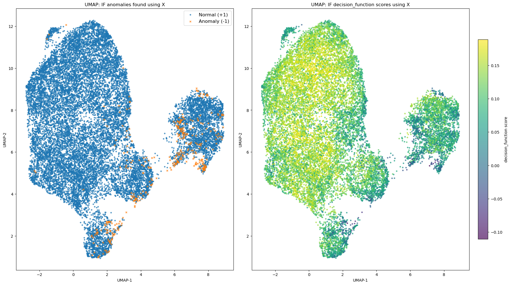

# Anomaly Detection on Ship Engine Sensor Data

Historical baseline evidence. The notebook and PDF are preserved, including known filtering and model-selection defects. Use the separate [corrected synthetic case](../../projects/ship-engine-anomalies/README.md) and [bounded executable example](../../examples/ship_engine_anomalies/README.md) for the new evaluation. This is not a newly verified original-data run.

- 

- **Problem**: Explore unusual sensor observations; downtime reduction and safety effects were not measured.
- **Data**: 19,535 records, 6 continuous sensors: `engine_rpm`, `oil_pressure`, `fuel_pressure`, `coolant_pressure`, `oil_temp`, `coolant_temp`.
- **Deliverables**: Jupyter notebook with analysis and figures, PDF report.

## Approach
- **EDA**: Distribution checks, pairplots, correlation heatmaps, boxplots. Identified two extreme coolant temperature outliers; flagged for domain review.
- **Statistical filtering**: Z-score (|z| ≥ 3), tail trimming (inner 95%), IQR-based multi-feature outlier scoring.
- **Scaling**: Standardisation for model stability.
- **Unsupervised models**:
  - One-Class SVM (RBF): grid over `gamma` and `nu`.
  - Isolation Forest: grid over `contamination`, `n_estimators`, `max_samples`.
- **Evaluation**: Separation between mean decision scores of inliers and outliers (normalised by score std). Dimensionality reduction visualisations with PCA and UMAP to inspect structure and decision landscapes.
- **Confluence analysis**: Agreement across IQR, OCSVM, and IF.

## Saved historical diagnostics
- **OCSVM (historically selected)**: `gamma=0.2`, `nu=0.02` → ~1.99% anomalies, highest separation (~3.36).
- **Isolation Forest (historically selected)**: `contamination=0.02`, `n_estimators=500`, `max_samples=512` → ~2.0% anomalies, separation ~3.10.
- **Agreement**: Majority of points flagged by zero or one method; a smaller subset flagged by two or all three methods shows detector agreement, not calibrated fault confidence.
- **Insights**: Little linear structure in PCA; UMAP offers clearer local neighbourhoods but anomalies are dispersed—consistent with multi-regime, non-linear sensor behaviour.

## Reproduction status

The saved notebook is historical evidence, not a verified clean execution route. It contains an inline installation step and reads a remote dataset. Do not infer executable reproducibility from saved figures. Original-data identity, units and permitted processing remain unresolved; no source data is bundled by this revision. The linked bounded example runs offline on independently invented records with explicit fit and evaluation cohorts.

## Repository Structure
- `McCann_David_CAM_C101_W5_Mini-project.ipynb` — full analysis and modelling.
- `McCann_David_CAM_C101_W5_Mini-project.pdf` — executive summary report.
- `README.md` — this overview.

## Notes
- Two observations with extreme `coolant_temp` merit data quality review.
- Alert rates depend on model settings and the evaluated population; no known fault rate is established.
