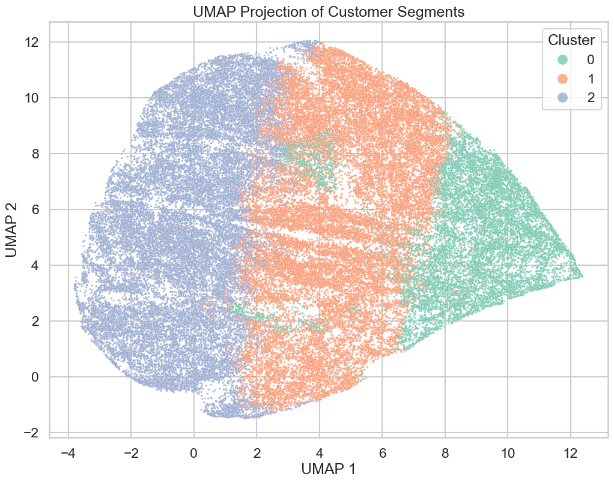

# Customer Segmentation with Clustering

> **Historical workflow — feature corrections required.** The original notebook and PDF below are preserved unchanged. Use the [corrected revision](../../examples/customer_segmentation/README.md) for tested sign handling, distinct-order counts, reconciliation and held-out cluster diagnostics on invented data. No corrected real-data rerun has been completed. The original text below describes the historical analysis: stripping parentheses lost negative signs; “frequency” counts lines; “CLV” is observed-period profit; average unit cost does not measure price sensitivity. Three clusters were chosen for interpretation despite stronger silhouette for two, and Ward linkage used only ten customers. Historical personas and campaign proposals are not validated outcomes.

- 

- **Problem**: Segment customers of a multinational e-commerce company to inform targeted marketing and retention strategies.
- **Data**: 951k+ order rows across 47 countries (2012–2016). Final modelling uses customer-level features: frequency, recency, CLV, average unit cost, and age.
- **Deliverables**: Jupyter notebook with full workflow and visuals, PDF report with findings and recommendations.

## Approach
- **Data cleaning**:
  - Normalised currency/percentage formats and negatives: removed `$`, `%`, `,` and parentheses; coerced to numeric.
  - Converted `Order_Date`, `Delivery_Date`, and `Customer_BirthDate` to datetime.
  - Verified missing values and types post-transformation.
- **Feature engineering**:
  - Customer-level aggregation to one row per customer.
  - Computed five core metrics: purchase frequency, recency, customer lifetime value (CLV), average unit cost, and customer age.
  - Scaled features (and encoded if required via pipelines/column transformers).
- **Model selection**:
  - Determined candidate `k` via Elbow and Silhouette analyses.
  - Explored hierarchical clustering (dendrogram) for structure and potential `k`.
  - Trained K-means with selected `k` and profiled clusters.
- **Visualisation**:
  - Boxplots of clusters vs. each feature (frequency, recency, CLV, avg. unit cost, age).
  - 2D embeddings with PCA and t-SNE to display cluster separation.

## Key Results
- **Optimal k**: Selected using Silhouette and Elbow criteria, corroborated by hierarchical structure.
- **Cluster profiles**: Distinct segments by spend (CLV), purchase cadence (frequency/recency), price sensitivity (avg. unit cost), and age bands. Actionable personas identified for targeted campaigns and retention strategies.

## How to Reproduce
**Historical instructions only:** the notebook fetches remote data and may run expensive full-cohort diagnostics. Do not treat the following as the supported offline route or as permission to reuse/redistribute the source dataset.

1. Open `McCann_David_CAM_C101_Week_6_Mini_project.ipynb`.
2. Ensure dependencies are installed:
   - pandas, numpy, scikit-learn, matplotlib, seaborn, scipy
3. Run cells sequentially. The notebook loads data from the provided public URL, performs cleaning, aggregation, selection of `k`, clustering, and visualisations.

## Repository Structure
- `McCann_David_CAM_C101_Week_6_Mini_project.ipynb` — full workflow and analysis.
- `McCann_David_CAM_C101_W6_Mini-project.pdf` — written report.
- `README.md` — this overview.

## Notes
- Large dataset (950k+ rows) may require sufficient memory to run locally.
- Replace public data URL if the source changes or becomes unavailable.
