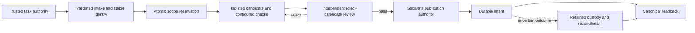

# Architecture and enforcement boundaries

The following is an abstract view of the private snapshot inspected on 27 November 2026. It describes source mechanisms, not an observed operational deployment. The public example uses a much smaller independently invented design.

| Boundary | What the inspected implementation enforces | Qualification |
| --- | --- | --- |
| Intake and identity | Bounded task schemas reject path/thread/profile injection; continuation metadata binds predecessor hashes and sequence. Native intake retains a unique plan and root key before issue creation. | Parsing is not authentication. Trusted policy, registry and acceptance readers provide authority. The older task identity includes the body hash: changed text is a distinct identity, subject to admission rules. |
| Writer ownership | Task admission uses an immediate SQLite transaction for replay, capacity and project reservation. Unresolved recovery retains the project writer reservation. | Project identifiers must correctly represent overlapping physical work. This is not distributed locking across arbitrary databases or aliases. |
| Source boundary | Workspace geometry, registered project and branch/base checks constrain worktree selection; reviewed candidate inventories bind file content and modes. | Static inspection here; no worktree creation or installed-source qualification was executed. Filesystem and configuration authority remain trusted. |
| Durable progress | Task status controls scheduling; phase/effect fields describe evidence. Dedicated evidence recording retains the higher proven effect and first published head. Publication intent is consumed conditionally. | The general state update API is not a complete allowed-transition graph. Monotonic evidence read/compare/write is not itself one atomic multi-writer operation; caller ownership matters. |
| Verification and review | Configured checks and candidate-bound review remain separate from a producer’s completion message. The isolated review model rejects producer identity, stale observations and packet drift, and preserves immutable verdicts. | The executed review tests exercise that separate model and recording transport, not the native reviewer lifecycle. Distinct strings alone do not authenticate independent people or contexts. |
| Recovery | Stale leases retain recovery custody. An existing publication intent allows readback without repeating the original effect. A later failure does not justify discarding previously proven publication. | Absence of readback is not evidence that nothing happened. Recovery may remain held; there is no automatic exactly-once guarantee. |
| Publication | Final publication checks reviewed physical content, test/source bindings, repository/base/branch identity, separate effect permissions and canonical acknowledgements. | Actual Git, remote permissions, CI, publication, merge and deployment were not exercised. Source acceptance grants none of those effects by itself. |

The accepted method separates source validation, publication, deliverable verification and external status projection. The selected source also contains newer native workflow components. Older architecture and runbook statements retain their dates; they are not used to infer which version is installed or whether a real task has completed. Exact source anchors, discrepancies and test selection are in the private review handoff.

[Case](README.md) · [Measured evidence](evidence.md) · [Independent example](../../examples/engineering_workflow/README.md)
