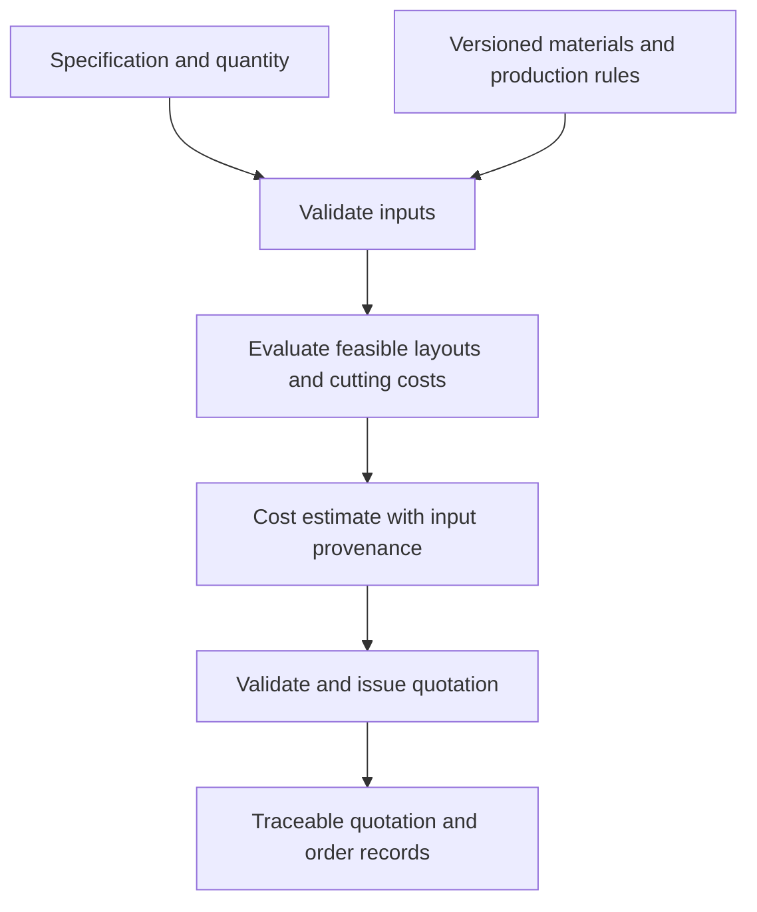

# KSP manufacturing management information system

**Role:** designer and implementer through QSol Analytics. **Status, 26 November 2026:** current private Python/FastAPI/PostgreSQL implementation; public architecture overview and a separately authored synthetic runnable example. Source implementation, historical verification and deployed operation are separate evidence levels.

## Problem and contribution

Packaging estimates depend on connected decisions: product dimensions, material choice, sheet utilisation, cutting operations, current prices and production rules. An estimate is difficult to explain or revisit if those inputs are scattered across spreadsheets or change without a retained version.

I designed and implemented a management information system connecting packaging specifications and production inputs to cost estimates, quotations and orders. My work includes relational modelling, structuring legacy spreadsheet information, constrained sheet-layout and cutting-cost optimisation, input validation, price provenance and traceable quotation records. The public explanation focuses on those mechanisms; it does not publish client prices, quotations or operational records.

## Data and calculation design

The inputs are operational specifications and reference data, rather than a labelled machine learning dataset. Product geometry, quantities, material-price versions and production constraints determine which calculations are meaningful. Relational records connect these inputs so a quotation can be traced back to the specification and price information used to create it.

Deterministic optimisation fits this problem because feasibility and cost depend on explicit physical and business rules. A low nominal sheet price alone does not identify the cheapest feasible production plan. Candidate layouts must satisfy dimensional constraints and be assessed alongside cutting costs. The implementation contains separate services for mixed-layout optimisation, material-price provenance and quote issuance, with structural payload checks around the quotation boundary.

This is a conceptual view of the implemented responsibilities. It omits client configuration and deployment details.

## Runnable synthetic decision

The [packaging layout and quote-provenance example](../../examples/packaging_optimisation/README.md) makes a bounded version of this decision inspectable. It is newly authored portfolio code using wholly synthetic inputs, independently of the private implementation. Run it offline with the Python standard library; its README supplies commands, precise assumptions, tests and hashed results.

For an invented order of 12 blanks, the lowest-priced feasible sheet gives a job cost of 600 synthetic minor units. Comparing material plus explicitly simplified cutting costs selects a larger sheet at 590. The [complete candidate table](../../examples/packaging_optimisation/results/initial_candidates.csv) shows both allowed orientations and rejected geometry. This is best among enumerated maximal uniform grids, not unrestricted packing optimality or a factory guillotine model.

A second price version changes the new estimate to 600 while the [issued snapshot](../../examples/packaging_optimisation/results/issued.json) retains the original inputs and 590 result. Canonical input hashes and replay make that difference explainable. The [manifest](../../examples/packaging_optimisation/results/manifest.json) binds these synthetic results to source and fixture hashes. The exact example and retained results received bounded review. Its tests and replay checks establish synthetic mechanics only; they do not validate the private MIS or establish commercial performance.

## Private implementation evidence and limits

The inspected implementation has focused tests for material-price provenance, atomic quote issuance and structural payload identity. It also defines offline release-qualification checks using synthetic receipts. These provide concrete inspection points for input lineage and transaction boundaries, rather than evidence of universal calculation accuracy.

Historical verification records include focused, regression and browser checks against particular source versions. They also retain deferred or blocked checks. Those records have not been rerun for this overview and cannot be transferred automatically to a later source revision. No live client workflow or production database was exercised to prepare this page.

The delivered engineering contribution is a connected estimating workflow with explicit constraints and traceable inputs. Its practical value is that an estimate has an inspectable basis and quotation issuance has a defined consistency boundary. Timing improvements, adoption, reduced commercial errors and return on investment require separately scoped measurements; none is asserted here. Current source also does not establish which revision is deployed.

## Public evidence and limits

The [legacy desktop estimator](../../KSP_Packaging_Estimator/README.md) is an earlier Tkinter/SQLite implementation preserved in this repository. It is useful historical source evidence, but it does not contain the current FastAPI/PostgreSQL MIS. Its setup and calculation paths need maintenance before it is offered as a fresh-checkout demonstration. Historical outcome statements in that folder are not adopted as evidence for this case, and its conflicting permission/licence statements require separate resolution before code reuse.

This overview describes the current private system; the separate synthetic example provides executable evidence of selected principles. Private code, client inputs, historical screenshots and release records are not included. Version-bound qualification of the private system and measured commercial outcomes remain separate work.

[Project index](../../docs/project-index.md) · [Provenance](../../docs/provenance.csv) · [Portfolio](../../README.md)
