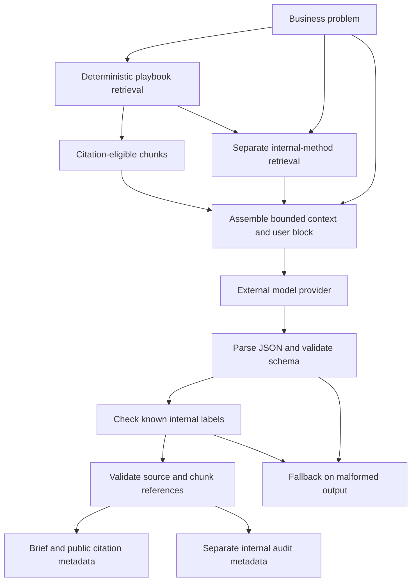

# Retrieval and validation architecture

This describes local commit `423399849406d1c78d68a162aadc6fd684082547`. The [older published classifier](https://github.com/Q-types/qsol-analytics-website/blob/2a9c9ddacb63dfe91f91f97f01c40729c224765d/src/lib/classifier.ts) supplies static context; it does not contain this later retrieval pipeline.

The taxonomy frames reporting, spreadsheet systems, forecasting, customer analysis, knowledge assistance, workflow automation and data readiness. Registered Markdown is split by headings. Retrieval ranks token overlap, phrases, categories and source-specific rules with deterministic tie-breaking. Defaults select at most two citation-eligible sources and two chunks per source. The public excerpt budget is 3,600 characters, with up to 700 per chunk; XML metadata and escaping add overhead, so this is not a total prompt or token cap. Internal retrieval separately selects at most five chunks, with at most two per source. “Hybrid” here means two context streams, not dense/sparse vector fusion.

A weak match can use generic readiness guidance while returning no visible citations. Internal context is omitted when public retrieval reports no relevant playbook. The new challenge shows this abstention rule is insufficient for several weak or irrelevant inputs; keyword matches can still produce visible sources. See the [measured scope](evidence.md).

The generation path assembles public context, internal guidance and an explicitly untrusted user block, then requests JSON from the provider. Zod checks structure and enums. Invalid JSON/schema or detected internal-label leakage triggers a fallback brief. Source and chunk references are checked against retrieved records and visibility permissions; invalid visible references clear citations and mark grounding as a fallback. Invalid internal references are excluded from audit metadata. A valid reference establishes membership in retrieved context, **not that the cited text entails the recommendation**. Omitted visible citations can be populated from retrieval defaults, so presence of citations does not prove model use.

Prompt assembly, schema checks, reference checks and email rendering were exercised offline. The production generation function, provider response handling as a complete live path, API persistence and actual email sending were not invoked. Provider errors and empty responses are distinct from malformed-output fallback; this evaluation does not establish their end-to-end handling. Several quality flags in the evaluation helper are test-time heuristics, not demonstrated production rejection rules.

Internal guidance crosses the provider boundary in the production request. Client-facing output excludes internal citation metadata, and a label-based leakage check catches known strings; that does not prove resistance to paraphrase leakage, prompt injection or disclosure. No security, secrecy, compliance or deployment guarantee follows. Project-fit scoring is fixed aggregation of model-supplied components, not statistical calibration.

[Case](README.md) · [Executed evidence](evidence.md) · [Invented illustration](illustrative-contract.md)
